# CHIP-8 Eval — DEMO report (synthetic models)

> **DEMO — synthetic data.** Every "model" below is the reference emulator with bugs patched in
> (see `report/demo.py`); episode statistics are made up. This page exists to show what the real
> report looks like and to test `report/make_report.py`. Real results go in `report/REPORT.md`.

## Results — `canonical`

### Overall — `canonical`

Scores are percentages: mean over runs, with (min–max). Overall = 0.5 × unit + 0.4 × program + 0.1 × robustness.

| Model | Runs | Overall | Unit | Program | Robustness | Submitted | Tool calls | Time | Cost/run |
|---|---|---|---|---|---|---|---|---|---|
| **demo-memorizer** | 3 | 99.6 (99–100) | 99.1 (97–100) | 100.0 (100–100) | 100.0 (100–100) | 2/3 | 113 | 40 min | $8.15 |
| **demo-careful** | 3 | 98.5 (95–100) | 99.4 (98–100) | 96.9 (91–100) | 100.0 (100–100) | 1/3 | 56 | 49 min | $4.32 |
| **demo-sloppy** | 3 | 89.4 (86–91) | 90.0 (83–94) | 86.0 (86–87) | 100.0 (100–100) | 2/3 | 96 | 42 min | $4.57 |

### Per-family pass rates — `canonical`

🟩 ≥ 95% · 🟨 ≥ 75% · 🟧 ≥ 40% · 🟥 < 40% (mean pass rate over runs)

| Model | flow | alu | load | memory | display | timers | input | random | halt | programs |
|---|---|---|---|---|---|---|---|---|---|---|
| **demo-careful** | 🟩 100 | 🟩 100 | 🟩 100 | 🟩 100 | 🟩 100 | 🟨 90 | 🟩 100 | 🟩 100 | 🟩 100 | 🟩 97 |
| **demo-memorizer** | 🟩 100 | 🟩 100 | 🟨 92 | 🟩 100 | 🟩 100 | 🟩 100 | 🟩 100 | 🟩 100 | 🟩 100 | 🟩 100 |
| **demo-sloppy** | 🟩 100 | 🟨 86 | 🟩 100 | 🟨 89 | 🟧 61 | 🟩 100 | 🟩 100 | 🟨 92 | 🟨 81 | 🟨 86 |

### Opcode-level failures — `canonical`

Only opcodes where some model lost points.

| Opcode | demo-careful | demo-memorizer | demo-sloppy |
|---|---|---|---|
| `00E0` | 🟩 100 | 🟩 100 | 🟧 67 |
| `8XY1` | 🟩 100 | 🟩 100 | 🟧 67 |
| `8XY2` | 🟩 100 | 🟩 100 | 🟧 67 |
| `8XY3` | 🟩 100 | 🟩 100 | 🟧 67 |
| `8XY4` | 🟩 100 | 🟩 100 | 🟨 92 |
| `8XY5` | 🟩 100 | 🟩 100 | 🟨 92 |
| `8XY6` | 🟩 100 | 🟩 100 | 🟨 89 |
| `8XY7` | 🟩 100 | 🟩 100 | 🟨 92 |
| `8XYE` | 🟩 100 | 🟩 100 | 🟨 89 |
| `CXNN` | 🟩 100 | 🟩 100 | 🟨 92 |
| `DXYN` | 🟩 100 | 🟩 100 | 🟧 59 |
| `FONT` | 🟩 100 | 🟩 100 | 🟨 83 |
| `FX07` | 🟨 83 | 🟩 100 | 🟩 100 |
| `FX15` | 🟨 89 | 🟩 100 | 🟩 100 |
| `FX1E` | 🟩 100 | 🟧 67 | 🟩 100 |
| `FX55` | 🟩 100 | 🟩 100 | 🟧 67 |
| `invalid` | 🟩 100 | 🟩 100 | 🟧 67 |

### Program checkpoints — `canonical`

Share of checkpoint frames matched exactly (mean over runs).

| Program | demo-careful | demo-memorizer | demo-sloppy |
|---|---|---|---|
| `bounce` | 🟩 100 | 🟩 100 | 🟧 73 |
| `collision_counter` | 🟩 100 | 🟩 100 | 🟥 33 |
| `fibonacci` | 🟩 100 | 🟩 100 | 🟩 100 |
| `font_dump` | 🟩 100 | 🟩 100 | 🟧 67 |
| `font_grid` | 🟩 100 | 🟩 100 | 🟨 75 |
| `jump_table` | 🟩 100 | 🟩 100 | 🟩 100 |
| `key_menu` | 🟩 100 | 🟩 100 | 🟩 100 |
| `maze` | 🟩 100 | 🟩 100 | 🟩 100 |
| `memcopy` | 🟩 100 | 🟩 100 | 🟩 100 |
| `nested_calls` | 🟩 100 | 🟩 100 | 🟩 100 |
| `pong` | 🟨 78 | 🟩 100 | 🟧 67 |
| `random_dots` | 🟩 100 | 🟩 100 | 🟨 75 |
| `score_counter` | 🟨 80 | 🟩 100 | 🟩 100 |
| `scroller` | 🟨 93 | 🟩 100 | 🟨 87 |
| `shift_art` | 🟩 100 | 🟩 100 | 🟧 67 |
| `timer_bar` | 🟨 94 | 🟩 100 | 🟩 100 |
| `typing` | 🟩 100 | 🟩 100 | 🟩 100 |

### How runs ended and test errors — `canonical`

| Model | Episode end reasons | Test errors (all runs) |
|---|---|---|
| **demo-careful** | max_tool_calls × 2, submitted × 1 | none |
| **demo-memorizer** | max_tool_calls × 1, submitted × 2 | none |
| **demo-sloppy** | max_tool_calls × 1, submitted × 2 | none |

### Most common unit-test failures — `canonical`

**demo-careful** (2 failures over 3 runs)

| Test | Runs failing | Mismatched fields |
|---|---|---|
| `timers_FX07_after_ticks` | 1/3 | state.v |
| `timers_FX15_set_on_tick` | 1/3 | state.dt |

**demo-memorizer** (3 failures over 3 runs)

| Test | Runs failing | Mismatched fields |
|---|---|---|
| `load_FX1E_add` | 1/3 | state.v |
| `load_FX1E_past_12_bits` | 1/3 | state.v |
| `load_FX1E_wrap_16_bits` | 1/3 | state.v |

**demo-sloppy** (34 failures over 3 runs)

| Test | Runs failing | Mismatched fields |
|---|---|---|
| `display_DXYN_clip_right` | 2/3 | final_frame, state.v |
| `display_DXYN_clip_bottom` | 2/3 | final_frame, state.v |
| `alu_8XY4_x_is_f` | 1/3 | state.v |
| `alu_8XY5_x_is_f` | 1/3 | state.v |
| `alu_8XY6_x_is_f` | 1/3 | state.v |
| `alu_8XY7_x_is_f` | 1/3 | state.v |
| `alu_8XYE_x_is_f` | 1/3 | state.v |
| `memory_FX55_partial` | 1/3 | state.v, state.i |

### Frame diffs — `canonical`

Each image shows **candidate | reference | diff**. In the diff, red pixels are lit only in the candidate's frame, green pixels only in the reference's, and grey pixels in both.

**demo-careful**

- `program_pong` — pong with scripted paddles, scores and DT pacing; run 3, checkpoint at cycle 721, pixel accuracy 99.9%

  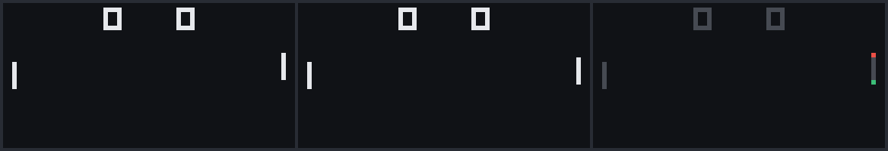

- `program_timer_bar` — timer-paced progress bar; run 3, checkpoint at cycle 4194, pixel accuracy 99.8%

  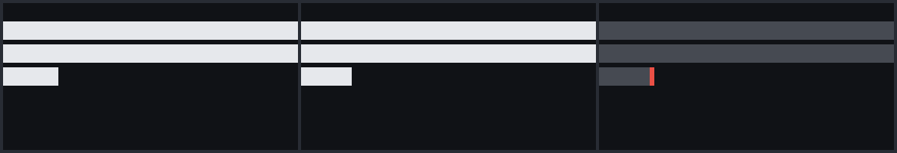

- `program_score_counter` — BCD score counter drawn with font sprites; run 3, checkpoint at cycle 1461, pixel accuracy 99.6%

  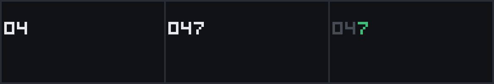

**demo-sloppy**

- `program_pong` — pong with scripted paddles, scores and DT pacing; run 3, checkpoint at cycle 721, pixel accuracy 100.0%

  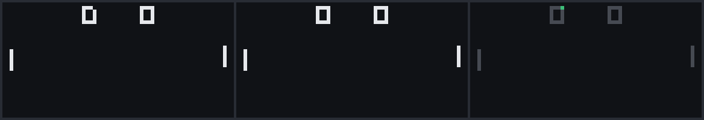

- `program_bounce` — ball bouncing off edges and obstacles; run 3, checkpoint at cycle 1324, pixel accuracy 99.8%

  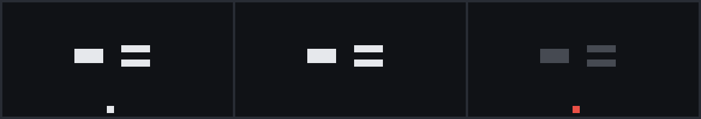

- `program_font_grid` — hex font grid redrawn with shifting offsets; run 1, checkpoint at cycle 700, pixel accuracy 99.3%

  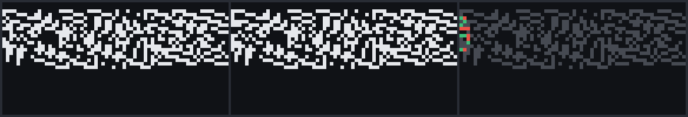

## Results — `variant_v`

### Overall — `variant_v`

Scores are percentages: mean over runs, with (min–max). Overall = 0.5 × unit + 0.4 × program + 0.1 × robustness.

| Model | Runs | Overall | Unit | Program | Robustness | Submitted | Tool calls | Time | Cost/run |
|---|---|---|---|---|---|---|---|---|---|
| **demo-careful** | 3 | 94.7 (85–100) | 98.9 (97–100) | 88.1 (66–100) | 100.0 (100–100) | 2/3 | 91 | 50 min | $5.33 |
| **demo-sloppy** | 3 | 87.1 (80–92) | 91.7 (90–95) | 78.1 (63–88) | 100.0 (100–100) | 1/3 | 85 | 76 min | $5.87 |
| **demo-memorizer** | 3 | 51.6 (50–54) | 81.0 (78–86) | 2.7 (3–3) | 100.0 (100–100) | 1/3 | 76 | 45 min | $7.69 |

### Per-family pass rates — `variant_v`

🟩 ≥ 95% · 🟨 ≥ 75% · 🟧 ≥ 40% · 🟥 < 40% (mean pass rate over runs)

| Model | flow | alu | load | memory | display | timers | input | random | halt | programs |
|---|---|---|---|---|---|---|---|---|---|---|
| **demo-careful** | 🟩 100 | 🟩 100 | 🟩 100 | 🟩 100 | 🟩 100 | 🟨 86 | 🟩 97 | 🟩 100 | 🟩 100 | 🟨 88 |
| **demo-memorizer** | 🟧 65 | 🟨 93 | 🟧 58 | 🟨 83 | 🟨 82 | 🟧 67 | 🟩 100 | 🟨 75 | 🟩 100 | 🟥 3 |
| **demo-sloppy** | 🟩 97 | 🟨 92 | 🟨 89 | 🟨 92 | 🟨 91 | 🟧 62 | 🟩 97 | 🟨 92 | 🟩 100 | 🟨 78 |

### Opcode-level failures — `variant_v`

Only opcodes where some model lost points.

| Opcode | demo-careful | demo-memorizer | demo-sloppy |
|---|---|---|---|
| `00E0` | 🟩 100 | 🟧 50 | 🟩 100 |
| `00EE` | 🟩 100 | 🟧 67 | 🟨 83 |
| `1NNN` | 🟩 100 | 🟧 50 | 🟨 83 |
| `3XNN` | 🟩 100 | 🟥 0 | 🟩 100 |
| `4XNN` | 🟩 100 | 🟥 0 | 🟩 100 |
| `5XY1` | 🟩 100 | 🟥 33 | 🟧 67 |
| `7XNN` | 🟩 100 | 🟥 33 | 🟧 67 |
| `8XY6` | 🟩 100 | 🟩 100 | 🟨 78 |
| `8XYE` | 🟩 100 | 🟩 100 | 🟨 78 |
| `CXNN` | 🟩 100 | 🟨 75 | 🟨 92 |
| `DXYN` | 🟩 100 | 🟨 89 | 🟨 89 |
| `FONT` | 🟩 100 | 🟥 0 | 🟩 100 |
| `FX07` | 🟩 100 | 🟩 100 | 🟧 67 |
| `FX0A` | 🟨 92 | 🟩 100 | 🟨 92 |
| `FX15` | 🟨 78 | 🟧 44 | 🟧 56 |
| `FX18` | 🟨 83 | 🟧 67 | 🟧 67 |
| `FX1E` | 🟩 100 | 🟧 67 | 🟨 89 |
| `FX29` | 🟩 100 | 🟥 0 | 🟩 100 |
| `FX33` | 🟩 100 | 🟩 100 | 🟨 75 |

### Program checkpoints — `variant_v`

Share of checkpoint frames matched exactly (mean over runs).

| Program | demo-careful | demo-memorizer | demo-sloppy |
|---|---|---|---|
| `bounce` | 🟩 100 | 🟥 33 | 🟩 100 |
| `collision_counter` | 🟩 100 | 🟥 0 | 🟧 42 |
| `fibonacci` | 🟧 67 | 🟥 0 | 🟧 44 |
| `font_dump` | 🟩 100 | 🟥 0 | 🟩 100 |
| `font_grid` | 🟩 100 | 🟥 0 | 🟨 78 |
| `jump_table` | 🟩 100 | 🟥 0 | 🟩 100 |
| `key_menu` | 🟩 100 | 🟥 0 | 🟩 100 |
| `maze` | 🟩 100 | 🟥 0 | 🟩 100 |
| `memcopy` | 🟩 100 | 🟥 25 | 🟨 75 |
| `nested_calls` | 🟧 67 | 🟥 0 | 🟨 75 |
| `pong` | 🟨 80 | 🟥 0 | 🟧 60 |
| `random_dots` | 🟩 100 | 🟥 0 | 🟨 83 |
| `score_counter` | 🟧 67 | 🟥 0 | 🟧 42 |
| `scroller` | 🟧 67 | 🟥 0 | 🟧 72 |
| `shift_art` | 🟩 100 | 🟥 0 | 🟩 100 |
| `timer_bar` | 🟧 67 | 🟥 0 | 🟧 67 |
| `typing` | 🟨 93 | 🟥 0 | 🟩 100 |

### How runs ended and test errors — `variant_v`

| Model | Episode end reasons | Test errors (all runs) |
|---|---|---|
| **demo-careful** | max_tool_calls × 1, submitted × 2 | none |
| **demo-memorizer** | max_tool_calls × 2, submitted × 1 | none |
| **demo-sloppy** | max_tool_calls × 2, submitted × 1 | none |

### Most common unit-test failures — `variant_v`

**demo-careful** (4 failures over 3 runs)

| Test | Runs failing | Mismatched fields |
|---|---|---|
| `timers_FX15_set_on_tick` | 1/3 | state.dt |
| `timers_FX15_countdown` | 1/3 | state.v |
| `timers_FX18_independent` | 1/3 | state.dt |
| `input_FX0A_lowest` | 1/3 | state.v |

**demo-memorizer** (66 failures over 3 runs)

| Test | Runs failing | Mismatched fields |
|---|---|---|
| `flow_1NNN_backward_loop` | 3/3 | state.v |
| `flow_3XNN_equal` | 3/3 | state.v |
| `flow_3XNN_not_equal` | 3/3 | state.v |
| `flow_3XNN_vf` | 3/3 | state.v |
| `flow_4XNN_equal` | 3/3 | state.v |
| `flow_4XNN_not_equal` | 3/3 | state.v |
| `flow_4XNN_vf` | 3/3 | state.v |
| `load_FX1E_wrap_16_bits` | 3/3 | state.v, state.i |

**demo-sloppy** (29 failures over 3 runs)

| Test | Runs failing | Mismatched fields |
|---|---|---|
| `timers_FX15_countdown` | 2/3 | state.v |
| `flow_1NNN_backward_loop` | 1/3 | state.v |
| `flow_00EE_nested_return` | 1/3 | state.v |
| `load_7XNN_no_overflow` | 1/3 | state.v |
| `load_7XNN_overflow` | 1/3 | state.v |
| `load_7XNN_x_is_f` | 1/3 | state.v |
| `load_FX1E_wrap_16_bits` | 1/3 | state.v |
| `display_DXYN_clip_right` | 1/3 | final_frame |

### Frame diffs — `variant_v`

Each image shows **candidate | reference | diff**. In the diff, red pixels are lit only in the candidate's frame, green pixels only in the reference's, and grey pixels in both.

**demo-careful**

- `program_pong` — pong with scripted paddles, scores and DT pacing; run 2, checkpoint at cycle 715, pixel accuracy 100.0%

  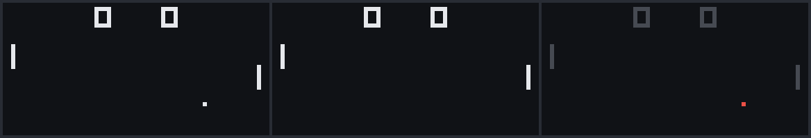

- `program_typing` — FX0A key echo with scripted typing; run 3, checkpoint at cycle 1243, pixel accuracy 99.9%

  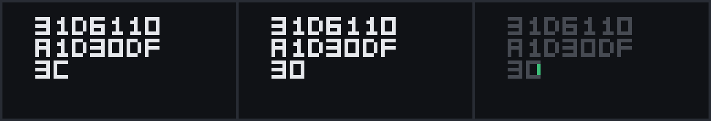

- `program_score_counter` — BCD score counter drawn with font sprites; run 2, checkpoint at cycle 1966, pixel accuracy 99.8%

  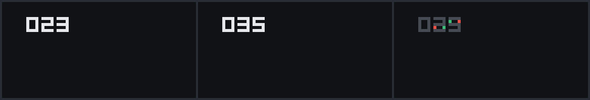

**demo-memorizer**

- `program_bounce` — ball bouncing off edges and obstacles; run 1, checkpoint at cycle 1296, pixel accuracy 99.8%

  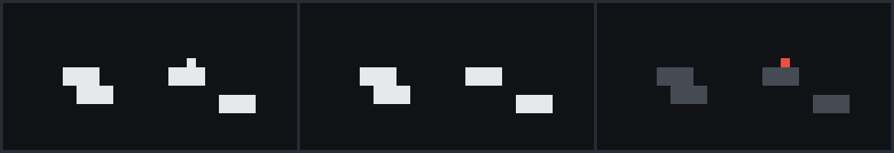

- `program_score_counter` — BCD score counter drawn with font sprites; run 1, checkpoint at cycle 2691, pixel accuracy 99.3%

  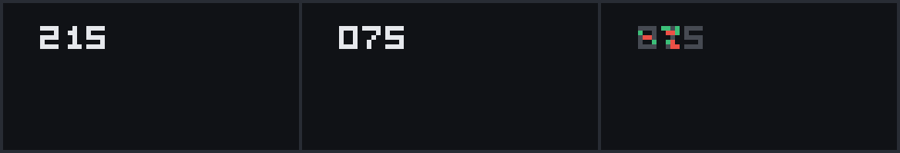

- `program_jump_table` — BNNN jump-table dispatch drawing glyphs; run 1, checkpoint at cycle 2882, pixel accuracy 99.3%

  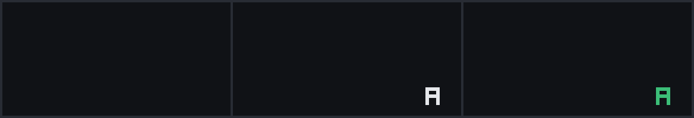

**demo-sloppy**

- `program_score_counter` — BCD score counter drawn with font sprites; run 3, checkpoint at cycle 2691, pixel accuracy 100.0%

  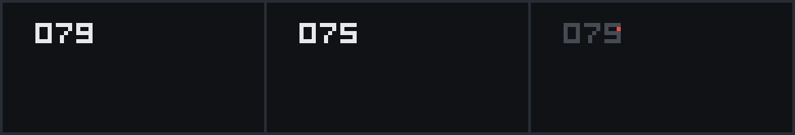

- `program_collision_counter` — random blocks with a VF collision counter; run 2, checkpoint at cycle 1371, pixel accuracy 99.9%

  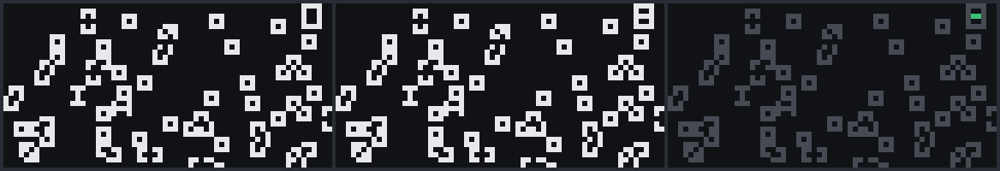

- `program_pong` — pong with scripted paddles, scores and DT pacing; run 3, checkpoint at cycle 312, pixel accuracy 99.9%

  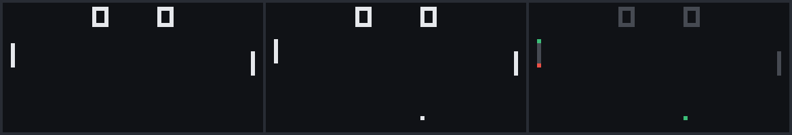

## Memorization gap

`variant_v` is the canonical machine with five deliberate changes, and the agent is told the spec overrides prior knowledge. The gap is canonical score minus variant score: how much a model's result depends on the machine matching standard CHIP-8.

| Model | Canonical overall | Variant overall | Gap (points) | Unit-score gap |
|---|---|---|---|---|
| **demo-careful** | 98.5 (95–100) | 94.7 (85–100) | **+3.8** | +0.6 |
| **demo-memorizer** | 99.6 (99–100) | 51.6 (50–54) | **+47.9** | +18.1 |
| **demo-sloppy** | 89.4 (86–91) | 87.1 (80–92) | **+2.3** | -1.7 |

### Which changes each model got wrong

For each change: pass rate on the variant tests whose graded output depends on that change. `k/n std` means that of `n` failures, `k` are reproduced exactly by the reference emulator with this change reverted to *standard* CHIP-8 behavior (the grader searches for the smallest set of reverted changes that reproduces each failure; the failure is attributed to the changes in that set). That is direct evidence the model followed prior knowledge instead of the spec.

| Model | font at 0x000 (FX29 = 5*VX) | 3XNN/4XNN swapped | 7XNN sets VF | timers every 8 cycles | 5XY1 multiply |
|---|---|---|---|---|---|
| **demo-careful** | 🟩 100 | 🟨 90 · 0/8 std | 🟩 96 · 0/1 std | 🟧 67 · 9/9 std | 🟩 100 |
| **demo-memorizer** | 🟥 0 · 21/21 std | 🟥 0 · 81/81 std | 🟥 17 · 16/20 std | 🟥 7 · 6/25 std | 🟥 33 · 6/6 std |
| **demo-sloppy** | 🟩 100 | 🟨 77 · 0/19 std | 🟧 62 · 8/9 std | 🟧 52 · 2/13 std | 🟧 67 · 3/3 std |

## Grader validation (mutants)

Before any model runs, the grader is checked against deliberately broken copies of the reference emulator (`grader/mutants.py`). It must score the reference 100%, every mutant below 100%, and each mutant must lose points in the opcode family it broke.

### `canonical`: reference 100%, 31 mutants, validation passed

| Mutant | Bug | Family | Family pass rate | Overall | Families that lost points |
|---|---|---|---|---|---|
| `alu_8xy5_flag_gt` | 8XY5 sets VF with > instead of >= | alu | 96% | 99.6% | alu |
| `alu_flag_before_result` | 8XY4/5/6/7/E write VF before the result | alu | 81% | 97.8% | alu |
| `alu_shift_uses_vy` | 8XY6/8XYE shift VY into VX (COSMAC quirk) | alu | 85% | 96.7% | alu |
| `alu_logic_resets_vf` | 8XY1/2/3 reset VF to 0 (COSMAC quirk) | alu | 77% | 96.9% | alu, random |
| `display_wrap_not_clip` | sprites wrap around the edges instead of clipping | display | 82% | 93.3% | display |
| `display_no_start_wrap` | DXYN start position is not wrapped (off-screen sprites vanish) | display | 82% | 94.9% | display |
| `display_vf_untouched` | DXYN never writes the collision flag | display | 0% | 89.4% | display, memory |
| `display_cls_noop` | 00E0 does not clear the screen | display | 82% | 93.3% | display |
| `memory_fx55_increments_i` | FX55 leaves I = I + X + 1 | memory | 75% | 92.9% | memory |
| `memory_fx65_increments_i` | FX65 leaves I = I + X + 1 | memory | 8% | 95.1% | memory |
| `memory_bcd_reversed` | FX33 stores the digits ones-first | memory | 75% | 93.9% | memory |
| `memory_unmasked` | memory addresses are not masked to 12 bits | memory | 92% | 99.5% | memory |
| `timers_period_off_by_one` | timers tick every 9 cycles (7 on variant_v) | timers | 29% | 85.2% | input, timers |
| `timers_tick_before_execute` | timers tick at the start of the cycle instead of the end | timers | 71% | 95.4% | timers |
| `timers_st_frozen` | the sound timer never counts down | timers | 71% | 99.1% | timers |
| `random_ignores_seed` | CXNN ignores --seed (always seed 1) | random | 25% | 92.4% | random |
| `random_low_bits` | rand() returns the low byte of the state | random | 0% | 91.9% | random |
| `input_fx0a_highest_key` | FX0A picks the highest-numbered key | input | 90% | 99.0% | input |
| `input_key_unmasked` | EX9E/EXA1 index keys with VX instead of VX & 0xF | input | 90% | 99.5% | input |
| `input_skip_ops_swapped` | EX9E and EXA1 swapped | input | 40% | 92.1% | input |
| `flow_call_pushes_old_pc` | 2NNN pushes the address of the call itself | flow | 82% | 71.6% | flow, halt |
| `flow_bnnn_uses_vx` | BNNN adds VX instead of V0 (SUPER-CHIP quirk) | flow | 91% | 95.5% | flow, halt |
| `flow_3xnn_inverted` | 3XNN skips on the wrong condition | flow | 82% | 63.2% | flow, load, random, timers |
| `load_7xnn_sets_vf` | 7XNN writes a carry flag | load | 67% | 96.5% | flow, load, random, timers |
| `load_fx1e_sets_vf` | FX1E sets VF when I passes 0xFFF (Amiga quirk) | load | 75% | 98.7% | load |
| `load_i_12_bit` | FX1E wraps I at 12 bits | load | 92% | 99.6% | load |
| `load_fx29_other_base` | FX29 uses the other machine's font base | load | 83% | 78.2% | display, load |
| `halt_invalid_is_noop` | invalid opcodes are ignored | halt | 44% | 97.8% | halt |
| `halt_stack_limit_17` | stack overflow only at 17 entries | halt | 89% | 99.6% | halt |
| `halt_pc_wraps` | PC wraps at 0x1000 instead of halting | halt | 78% | 99.1% | halt |
| `halt_underflow_ignored` | 00EE with an empty stack is a no-op | halt | 89% | 99.6% | halt |

### `variant_v`: reference 100%, 35 mutants, validation passed

| Mutant | Bug | Family | Family pass rate | Overall | Families that lost points |
|---|---|---|---|---|---|
| `alu_8xy5_flag_gt` | 8XY5 sets VF with > instead of >= | alu | 97% | 99.6% | alu |
| `alu_flag_before_result` | 8XY4/5/6/7/E write VF before the result | alu | 83% | 97.8% | alu |
| `alu_shift_uses_vy` | 8XY6/8XYE shift VY into VX (COSMAC quirk) | alu | 86% | 96.6% | alu |
| `alu_logic_resets_vf` | 8XY1/2/3 reset VF to 0 (COSMAC quirk) | alu | 79% | 97.4% | alu |
| `display_wrap_not_clip` | sprites wrap around the edges instead of clipping | display | 73% | 92.1% | display |
| `display_no_start_wrap` | DXYN start position is not wrapped (off-screen sprites vanish) | display | 82% | 95.3% | display |
| `display_vf_untouched` | DXYN never writes the collision flag | display | 9% | 89.8% | display, memory |
| `display_cls_noop` | 00E0 does not clear the screen | display | 82% | 94.2% | display |
| `memory_fx55_increments_i` | FX55 leaves I = I + X + 1 | memory | 75% | 93.8% | memory |
| `memory_fx65_increments_i` | FX65 leaves I = I + X + 1 | memory | 8% | 95.3% | memory |
| `memory_bcd_reversed` | FX33 stores the digits ones-first | memory | 75% | 93.8% | memory |
| `memory_unmasked` | memory addresses are not masked to 12 bits | memory | 92% | 99.5% | memory |
| `timers_period_off_by_one` | timers tick every 9 cycles (7 on variant_v) | timers | 0% | 83.4% | input, timers |
| `timers_tick_before_execute` | timers tick at the start of the cycle instead of the end | timers | 71% | 96.4% | timers |
| `timers_st_frozen` | the sound timer never counts down | timers | 71% | 99.1% | timers |
| `random_ignores_seed` | CXNN ignores --seed (always seed 1) | random | 25% | 91.6% | random |
| `random_low_bits` | rand() returns the low byte of the state | random | 0% | 91.1% | random |
| `input_fx0a_highest_key` | FX0A picks the highest-numbered key | input | 90% | 99.0% | input |
| `input_key_unmasked` | EX9E/EXA1 index keys with VX instead of VX & 0xF | input | 90% | 99.5% | input |
| `input_skip_ops_swapped` | EX9E and EXA1 swapped | input | 40% | 90.3% | input |
| `flow_call_pushes_old_pc` | 2NNN pushes the address of the call itself | flow | 82% | 72.8% | flow, halt |
| `flow_bnnn_uses_vx` | BNNN adds VX instead of V0 (SUPER-CHIP quirk) | flow | 91% | 97.1% | flow, halt |
| `flow_3xnn_inverted` | 3XNN skips on the wrong condition | flow | 86% | 82.3% | flow |
| `load_fx1e_sets_vf` | FX1E sets VF when I passes 0xFFF (Amiga quirk) | load | 83% | 99.1% | load |
| `load_i_12_bit` | FX1E wraps I at 12 bits | load | 92% | 99.6% | load |
| `load_fx29_other_base` | FX29 uses the other machine's font base | load | 83% | 76.9% | display, load |
| `halt_invalid_is_noop` | invalid opcodes are ignored | halt | 44% | 97.8% | halt |
| `halt_stack_limit_17` | stack overflow only at 17 entries | halt | 89% | 99.6% | halt |
| `halt_pc_wraps` | PC wraps at 0x1000 instead of halting | halt | 78% | 99.1% | halt |
| `halt_underflow_ignored` | 00EE with an empty stack is a no-op | halt | 89% | 99.6% | halt |
| `revert_font_addr` | variant_v with the font at 0x050 (standard CHIP-8) | load | 83% | 94.1% | display, load, memory |
| `revert_skip_swap` | variant_v with standard 3XNN/4XNN | flow | 68% | 56.8% | flow, load, random, timers |
| `revert_add_vf` | variant_v with standard 7XNN (VF untouched) | load | 67% | 96.5% | flow, load, random, timers |
| `revert_timer_period` | variant_v with timers every 10 cycles | timers | 57% | 85.0% | timers |
| `revert_mul` | variant_v without the 5XY1 multiply | alu | 90% | 98.7% | alu |

## All runs

Each run's `viewer.html` (open locally in a browser) shows every test's expected vs actual state and frames.

| Run | End | Tool calls | Time | Cost | Overall | Details |
|---|---|---|---|---|---|---|
| `demo-careful__canonical__r1` | submitted | 77 | 61 min | $2.39 | 100.0% | [viewer](../../results/demo_runs/demo-careful__canonical__r1/viewer.html) |
| `demo-careful__canonical__r2` | max_tool_calls | 35 | 22 min | $2.51 | 100.0% | [viewer](../../results/demo_runs/demo-careful__canonical__r2/viewer.html) |
| `demo-careful__canonical__r3` | max_tool_calls | 56 | 65 min | $8.06 | 95.4% | [viewer](../../results/demo_runs/demo-careful__canonical__r3/viewer.html) |
| `demo-memorizer__canonical__r1` | max_tool_calls | 82 | 75 min | $10.92 | 100.0% | [viewer](../../results/demo_runs/demo-memorizer__canonical__r1/viewer.html) |
| `demo-memorizer__canonical__r2` | submitted | 122 | 26 min | $8.29 | 98.7% | [viewer](../../results/demo_runs/demo-memorizer__canonical__r2/viewer.html) |
| `demo-memorizer__canonical__r3` | submitted | 134 | 19 min | $5.25 | 100.0% | [viewer](../../results/demo_runs/demo-memorizer__canonical__r3/viewer.html) |
| `demo-sloppy__canonical__r1` | submitted | 107 | 19 min | $6.94 | 91.1% | [viewer](../../results/demo_runs/demo-sloppy__canonical__r1/viewer.html) |
| `demo-sloppy__canonical__r2` | submitted | 92 | 36 min | $2.63 | 90.7% | [viewer](../../results/demo_runs/demo-sloppy__canonical__r2/viewer.html) |
| `demo-sloppy__canonical__r3` | max_tool_calls | 88 | 71 min | $4.14 | 86.3% | [viewer](../../results/demo_runs/demo-sloppy__canonical__r3/viewer.html) |
| `demo-careful__variant_v__r1` | submitted | 92 | 72 min | $5.30 | 100.0% | [viewer](../../results/demo_runs/demo-careful__variant_v__r1/viewer.html) |
| `demo-careful__variant_v__r2` | max_tool_calls | 54 | 65 min | $1.99 | 85.0% | [viewer](../../results/demo_runs/demo-careful__variant_v__r2/viewer.html) |
| `demo-careful__variant_v__r3` | submitted | 127 | 13 min | $8.71 | 99.0% | [viewer](../../results/demo_runs/demo-careful__variant_v__r3/viewer.html) |
| `demo-memorizer__variant_v__r1` | submitted | 43 | 18 min | $4.72 | 50.3% | [viewer](../../results/demo_runs/demo-memorizer__variant_v__r1/viewer.html) |
| `demo-memorizer__variant_v__r2` | max_tool_calls | 41 | 78 min | $10.94 | 50.3% | [viewer](../../results/demo_runs/demo-memorizer__variant_v__r2/viewer.html) |
| `demo-memorizer__variant_v__r3` | max_tool_calls | 145 | 38 min | $7.40 | 54.2% | [viewer](../../results/demo_runs/demo-memorizer__variant_v__r3/viewer.html) |
| `demo-sloppy__variant_v__r1` | submitted | 139 | 68 min | $2.48 | 88.7% | [viewer](../../results/demo_runs/demo-sloppy__variant_v__r1/viewer.html) |
| `demo-sloppy__variant_v__r2` | max_tool_calls | 42 | 83 min | $8.59 | 92.5% | [viewer](../../results/demo_runs/demo-sloppy__variant_v__r2/viewer.html) |
| `demo-sloppy__variant_v__r3` | max_tool_calls | 75 | 78 min | $6.54 | 80.0% | [viewer](../../results/demo_runs/demo-sloppy__variant_v__r3/viewer.html) |
